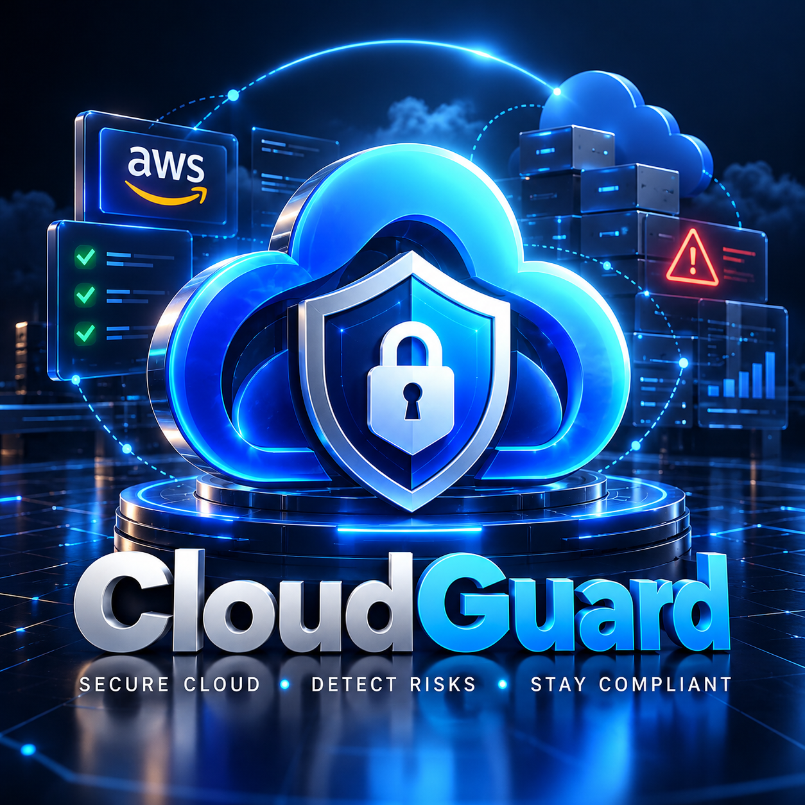
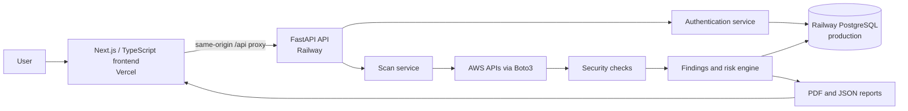

<div align="center">



# CloudGuard

### AWS Cloud Security Misconfiguration Detection & Risk Assessment Platform

[](https://www.python.org/)
[](https://www.typescriptlang.org/)
[](https://fastapi.tiangolo.com/)
[](https://aws.amazon.com/)
[](https://boto3.amazonaws.com/)

**Detect misconfigurations. Assess risk. Improve your AWS security posture.**

</div>

---

**A web-based AWS cloud security misconfiguration detection and risk assessment platform.**

## Overview

CloudGuard checks AWS account configuration for selected security conditions, explains its findings, and produces a severity-based posture score. The production web application uses a Next.js frontend on Vercel and a FastAPI backend on Railway. The backend uses Railway PostgreSQL for production accounts and scan history, and AWS APIs through Boto3 for live assessments.

The repository also contains local CLI and Streamlit tools. These are development tools; the production frontend is the separate Next.js application.

## Key Features

- Account signup and login with session-based authentication.
- AWS connection verification before starting a scan.
- Live AWS checks for IAM, S3, Security Groups, Network ACLs, and CloudTrail logging.
- CRITICAL, HIGH, MEDIUM, LOW, and PASS finding classifications with remediation guidance.
- A normalized security score and rating based on the implemented checks.
- Per-user scan history and latest scan persistence.
- Downloadable PDF reports and JSON export.
- Production deployment with the Vercel frontend proxying `/api/*` requests to the existing Railway API.

## System Architecture



For local backend development, CloudGuard uses SQLite unless a PostgreSQL `DATABASE_URL` is configured. In production, the backend requires PostgreSQL when running on Railway.

## Scan Flow

```text
Login → Configure AWS access → Verify AWS identity with STS → Run scan
      → Execute security checks → Review findings and score
      → Persist scan result/history → Download PDF or JSON
```

## Security Checks

| Area | What the implemented checks inspect |
| --- | --- |
| IAM | User MFA configuration and access-key last-used information. |
| S3 | Bucket ACLs, encryption, access logging, bucket policies, public-access blocks, and versioning. |
| Security Groups | Inbound exposure in configured security groups. |
| Network ACLs | Network ACL traffic rules and exposure conditions. |
| CloudTrail | Whether trails exist and whether logging is enabled. |

Results depend on the AWS identity's access and the resources available in the scanned account and region.

## Security Score

The backend's authoritative score uses these penalties for each applicable check:

| Finding severity | Penalty |
| --- | ---: |
| CRITICAL | 20 |
| HIGH | 10 |
| MEDIUM | 5 |
| LOW | 2 |
| PASS | 0 |

The score is normalized to 0–100 against the maximum penalty of 20 per unique check:

```text
score = max(0, 100 × (1 − total penalty / (20 × number of unique checks)))
```

PASS checks contribute zero penalty and remain in the denominator. The rating bands are:

| Score | Rating |
| ---: | --- |
| 90–100 | Excellent |
| 75–89 | Good |
| 60–74 | Needs Improvement |
| 40–59 | Poor |
| 0–39 | Critical |

This is a project-specific risk heuristic, not a formal compliance certification. An empty scan currently scores 100; interpret that result alongside the reported check coverage.

## Technology Stack

| Layer | Technologies |
| --- | --- |
| Frontend | Next.js, React, TypeScript, Tailwind CSS, Radix UI components |
| Backend | Python, FastAPI, Uvicorn, Boto3 |
| Authentication | Argon2id password hashing and signed session cookies |
| Database | Railway PostgreSQL in production; SQLite for local backend development |
| Reports | ReportLab PDF generation and JSON export |
| Testing | pytest; frontend Node tests, TypeScript, and Next.js build checks |
| Deployment | Vercel frontend and Railway API/database |

## Authentication and Security

- Passwords are hashed with Argon2id; the API uses a signed, session-based authentication cookie.
- Production session cookies are HTTPS-only and use `SameSite=None`. The Vercel frontend sends API requests through its same-origin `/api/*` proxy to Railway.
- The API allows credentialed CORS with explicit origins; the canonical production frontend origin is `https://cloud-guard-frontend-five.vercel.app`.
- Production AWS access keys entered in the frontend remain in React component memory for the active scan flow. They are not written to local or session storage, cookies, the database, or reports. They are cleared after a scan attempt or logout and disappear when the page is refreshed.
- Use a dedicated read-oriented AWS scanning identity and grant only the permissions needed for the checks you run. Do not use AWS root credentials.
- The API validates request data and adds security response headers. Supply deployment secrets through environment variables; never commit secrets or credentials to Git.

## Production Deployment

- Frontend: [https://cloud-guard-frontend-five.vercel.app](https://cloud-guard-frontend-five.vercel.app)
- Backend health endpoint: [https://cloudguard-production-9db9.up.railway.app/api/health](https://cloudguard-production-9db9.up.railway.app/api/health)

The browser calls the frontend's `/api/*` routes. Vercel forwards those requests to the existing Railway FastAPI backend; Railway remains the API and database runtime.

## Local Development

### Backend

From a clone of this repository:

```bash
cd CloudGuard
python3 -m venv .venv
source .venv/bin/activate
pip install -r requirements.txt
```

Start the FastAPI API with a local-only session secret:

```bash
CLOUDGUARD_SESSION_SECRET="local-api-test-secret" PYTHONPATH=. \
  uvicorn api.main:app --host 127.0.0.1 --port 8000
```

The backend defaults to local SQLite. To use PostgreSQL locally, set `DATABASE_URL` in your environment. Copy `.env.example` as a reference and replace its placeholder values locally; do not commit populated environment files.

### Frontend

Clone the frontend repository alongside the backend repository, then run:

```bash
cd CloudGuard-Frontend
pnpm install
```

Set `NEXT_PUBLIC_API_BASE_URL` to the existing API origin for local development (for example, `http://127.0.0.1:8000`) and start the development server:

```bash
pnpm dev
```

In production, this variable supplies the destination for the Vercel `/api/*` rewrite to Railway. It is an API origin, not a secret.

### Optional local CLI and Streamlit tools

The backend repository retains the CLI and Streamlit dashboard. Install the backend dependencies as above. Configure AWS credentials using the AWS CLI or standard Boto3 credential chain, then run:

```bash
python cloudguard.py scan
streamlit run dashboard/app.py
```

These local tools are separate from the production Next.js web application.

## Testing

### Backend

Install test dependencies and run the backend suite from the repository root:

```bash
pip install -r requirements-dev.txt
PYTHONPATH=. pytest -v
```

### Frontend

From the frontend repository root, the available package scripts are:

```bash
pnpm test
pnpm exec tsc --noEmit --incremental false
pnpm build
```

## Project Structure

```text
CloudGuard/
├── api/                  # FastAPI authentication and AWS endpoints
├── auth/                 # Authentication and password hashing services
├── cloudguard/           # AWS scanners, findings, scoring, and reporting
├── database/             # SQLite/PostgreSQL access and scan persistence
├── dashboard/            # Optional local Streamlit dashboard
├── docs/                 # Architecture and security model documentation
├── engine/               # Scan engine and plugin registry
├── plugins/              # IAM, S3, VPC, and CloudTrail checks
├── tests/                # Backend test suite
├── Infrastructure/       # Terraform lab resources
├── cloudguard.py         # Local CLI entry point
├── plugin_manager.py     # Plugin discovery and loading
├── requirements.txt      # Runtime dependencies
├── requirements-dev.txt  # Test dependencies
└── .env.example          # Environment variable template
```

## Reports

CloudGuard provides a PDF report and a JSON export for the latest persisted scan. Reports contain scan metadata, the score, findings, and recommendations. AWS credentials are excluded from scan persistence and report output; reports should still be handled as security-sensitive assessment data.

## Limitations

- CloudGuard is an AWS-focused assessment tool, not a general-purpose cloud security platform.
- Findings depend on AWS permissions, account configuration, region, and the checks implemented by the project.
- A PASS means that an implemented check did not detect its tested condition; it does not prove that a resource or account is completely secure.
- The security score is project-specific and is not a compliance certification.
- Validate recommendations against your environment and change process before applying them in production.

## Academic Project

**Title:** Cloud Guard : A Web-Based AWS Cloud Security Misconfiguration Detection and Risk Assessment System

**Developer:** Vinit Dangi

**Program:** BCA — Cloud Security

### Attribution

This project is based on and extends the original CloudGuard project by Mohsan Razaq.

Original repository: [MohsanRazaq/CloudGuard](https://github.com/MohsanRazaq/CloudGuard)

The original project's architecture and implementation were used as a starting point. Original authorship is acknowledged; this repository also contains project-specific changes and extensions.

### License

The original CloudGuard repository does not currently provide a clearly identified open-source license. This repository therefore does not claim an open-source license for inherited or derived portions of the project. The original author's rights and attribution are respected.

## Final Project Status

The application is deployed and has been validated with a real AWS security scan, including findings, a security score, persisted scan history, a PDF report, and JSON export.
